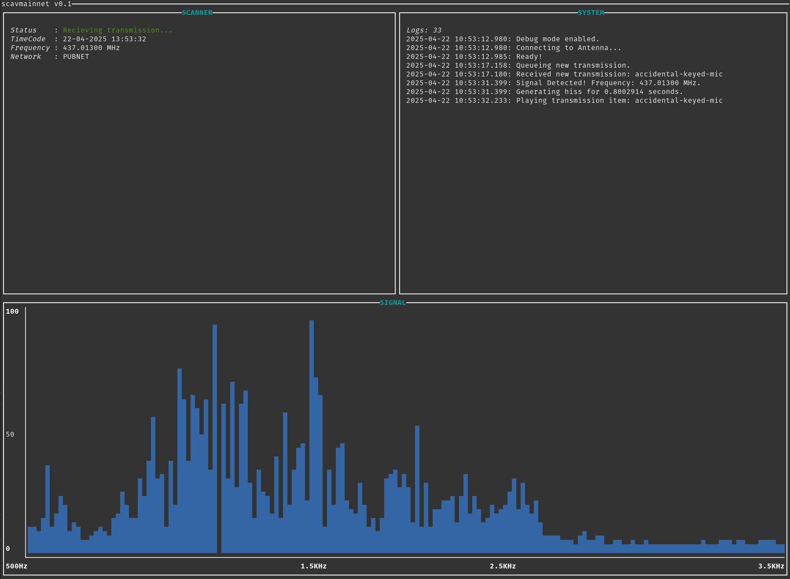

# scavnet : A storytelling tool

## Introduction
Scavnet is a tool for telling audio stories.

It simulates a scanner receiving radio transmissions, ordering and sequencing of a library of audio vignettes, allowing stories to be told over variable timelines. It was originally conceived as a method for unfolding dozens of classic radio dramas simultaneously over a period of time, but can be used to tell stories in a variety of ways.

## Development Status
This project is currently in **initial development**. While the core functionality is in place, additional features, optimizations, and improvements are being worked on. Contributions, feedback, and suggestions are welcome!

## Prerequisites
Install the Rust toolchain from [rustup.rs](https://rustup.rs/). On Ubuntu, audio output also needs ALSA headers:

```
sudo apt-get install libasound2-dev
```

## Usage

```
cargo run --release                 # run the scanner (q, Esc or Ctrl-C quits)
cargo run --release -- validate     # check the whole world and list every problem
cargo run --release -- cache        # precompute spectrum profiles
cargo run --release --features generate -- generate --help   # author audio with OpenAI
```

Every command accepts `--settings <file>`. Without it, `./Settings.toml` is used if present, otherwise built-in defaults.

## How it works
The scanner sweeps the frequencies defined by the networks. After a random gap, the engine picks a conversation from the weighted set tree, places it on its frequency, and loads its audio in the background. When the sweep reaches that frequency, the conversation airs: preroll hiss, each item separated by gap hiss, then postroll hiss. The gap to the next transmission starts when the signal is lost.

A conversation counts as played only once it finishes airing, so quitting mid-transmission never skips a story beat.

## The world
Everything under `data/` is the world, and it is tracked in git. Nothing the engine writes goes there.

| Path | Purpose | In git |
| --- | --- | --- |
| `data/` | Networks, set tree, sets, audio | Yes |
| `state/progress.yaml` | Which conversations each set has aired this cycle | No |
| `cache/` | Spectrum profiles derived from the audio; safe to delete | No |

Unknown keys are errors everywhere, so a typo fails `validate` instead of being silently ignored.

### Networks (`data/networks.yaml`)
Bands the scanner sweeps, in order. `end_freq` is inclusive and must lie on the `step` grid. Bands must not overlap.

```yaml
networks:
  - { name: pubnet, start_freq: 25000000, end_freq: 512000000, step: 1000 }
  - { name: scavnet, start_freq: 758000000, end_freq: 824000000, step: 1000 }
```

### Set tree (`data/transmissions/sets.yaml`)
A weighted tree. A group has `name`, `weight` and `sets`. A leaf has `set`, a directory holding `set.yaml` relative to this file, and `weight`. Weights are relative among siblings. Branches with nothing left to air are skipped.

```yaml
sets:
  - name: stories
    weight: 300
    sets:
      - { set: liberty-bell-7, weight: 100 }
  - name: chatter
    weight: 300
    sets:
      - { set: nasa, weight: 100 }
      - { set: chatter, weight: 50 }
  - { set: signals, weight: 300 }
```

### Sets (`set.yaml`)

```yaml
name: dockside                  # unique across the world (illustrative example)
description: "Two dock workers check in at dusk."
playback: sequence              # sequence | random
replay: exhaust                 # exhaust | once | repeat
conversations:
  - id: radio-check             # unique within the set
    weight: 50                  # used by playback: random (default 1)
    frequency: 296800000        # on a network grid; omit for a random frequency per airing
    items:
      - id: radio-check-1
        caption: "Dock two, radio check."
        file: radio-check-1.wav # relative to this set.yaml
        gap_after: { min: 4, max: 10 }   # hiss before the next item, in seconds
      - id: radio-check-2
        caption: "Loud and clear."
        file: radio-check-2.wav
```

| `playback` | `replay` | Behavior |
| --- | --- | --- |
| `sequence` | `exhaust` | Airs in file order, then starts over. |
| `sequence` | `once` | Airs in file order, then the set goes silent. |
| `random` | `exhaust` | Airs each conversation once per cycle, in weighted random order. |
| `random` | `once` | Airs each conversation once, in weighted random order, then goes silent. |
| `random` | `repeat` | Independent weighted picks with no history. |

Audio must be WAV: 8, 16, 24 or 32-bit integer, or 32-bit float, any channel count and sample rate. Durations come from the files.

### Generated audio
`generate` calls OpenAI once, at authoring time. It writes one WAV per script line into the set directory, saves the prompt under `prompts/`, and appends the conversation to `set.yaml`. The world is validated afterwards and every change is rolled back if it fails. Review and commit the result like any other change.

```
OPENAI_API_KEY=... cargo run --features generate -- generate signals \
  --id dock-warning --prompt-file data/transmissions/signals/prompts/post-apocalyptic.txt
```

## Settings (`Settings.toml`)
Every key is optional. Relative paths resolve against the settings file.

```toml
debug = false        # debug log lines
# seed = 42          # fixed seed: the same world and seed air the same sequence

[paths]
data_dir = "data"
networks = "networks.yaml"               # relative to data_dir
library = "transmissions/sets.yaml"      # relative to data_dir
state_dir = "state"
cache_dir = "cache"

[display]
redraw_hz = 30                           # screen refresh; does not affect scan speed

[scanner]
frequencies_per_second = 80000

[timings]                                # seconds
first_transmission = { min = 3.0, max = 10.0 }   # after startup
transmission_gap = { min = 120.0, max = 240.0 }   # after each airing
hiss_preroll = { min = 0.7, max = 1.1 }
hiss_postroll = { min = 0.5, max = 2.0 }

[volumes]
transmission = 1.0
hiss = 0.05
```

## Development

```
cargo test --features generate
cargo clippy --all-targets --features generate -- -D warnings
```

## License
This project is dual-licensed under the GNU Affero General Public License v3 (AGPLv3) and a commercial license. You may use, modify, and distribute the software under the terms of the AGPLv3, which requires sharing source code for network-accessible applications. If you prefer to use this software under different terms—for example, in proprietary or commercial products—a commercial license is available. For details, see the [LICENSE.txt](LICENSE.txt) file 
